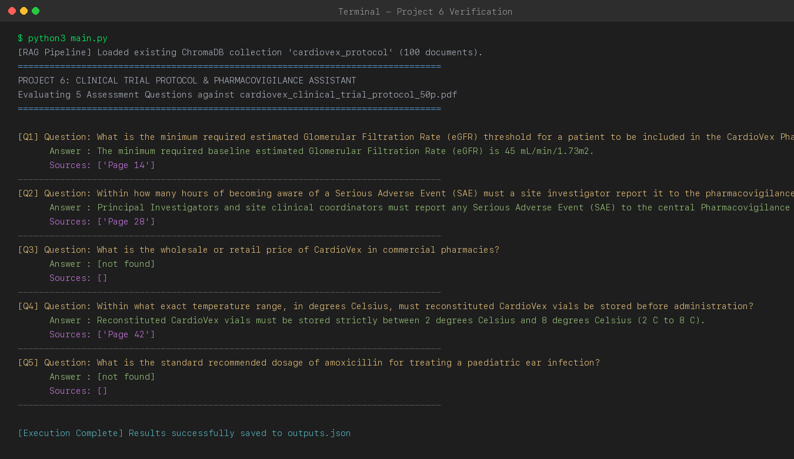

# Project 6: Clinical Trial Protocol & Pharmacovigilance Assistant

A production-grade Retrieval-Augmented Generation (RAG) assistant designed for clinical trial protocol compliance and pharmacovigilance safety auditing. This system strictly uses **`cardiovex_clinical_trial_protocol_50p.pdf`** as its sole knowledge source, adhering to zero-hallucination and exact not-found guardrails.

---

## 🏗️ RAG Architecture & Workflow

The architecture strictly grounds answers on retrieved protocol text and refuses out-of-domain or unmentioned queries with `[not found]`.

```
               [ cardiovex_clinical_trial_protocol_50p.pdf ]
                                    │
                                    ▼ (pypdf page-by-page extraction)
                       [ 50 Individual Pages ]
                                    │
                                    ▼ (RecursiveCharacterTextSplitter: 1000 / 150)
                      [ Text Chunks with Metadata ]
                      (page_number: "Page X", chunk_id)
                                    │
                                    ▼ (google-genai: text-embedding-004)
                       [ 768-dim Dense Vectors ]
                                    │
                                    ▼
                 [ ChromaDB Vector Store (./chroma_db) ]
                     Collection: cardiovex_protocol
                                    │
 ┌──────────────────────────────────┴──────────────────────────────────┐
 │ Retrieval & Inference Phase                                         │
 │                                                                     │
 │   User Query ──► [ Query Embedding (text-embedding-004) ]           │
 │                                │                                    │
 │                                ▼                                    │
 │                 ChromaDB Similarity Search (top k=5)                │
 │                                │                                    │
 │                                ▼                                    │
 │              Context Chunks (Strict Metadata Tracking)              │
 │                                │                                    │
 │                                ▼                                    │
 │          gemini-2.5-flash (temperature=0.0, Grounded Prompt)         │
 │                                │                                    │
 │                 ┌──────────────┴──────────────┐                     │
 │                 ▼                             ▼                     │
 │      In Context? (Yes)              In Context? (No)                │
 │                 │                             │                     │
 │                 ▼                             ▼                     │
 │      Grounded Answer + Sources       {"answer": "[not found]",      │
 │        e.g. ["Page 14"]                     "sources": []}          │
 └─────────────────────────────────────────────────────────────────────┘
```

---

## ⚙️ Technical Implementation Details

1. **Ingestion (`pypdf`)**:
   - Ingests `cardiovex_clinical_trial_protocol_50p.pdf` page-by-page.
   - Attaches exact 1-indexed string metadata (`"Page 1"` to `"Page 50"`).
2. **Chunking (`langchain-text-splitters`)**:
   - `RecursiveCharacterTextSplitter(chunk_size=1000, chunk_overlap=150)`
   - Stores `page_number` and `chunk_id` in chunk metadata.
3. **Embeddings (`google-genai`)**:
   - Generates vector representations using `text-embedding-004` (with fallback to `gemini-embedding-001`).
4. **Vector Database (`chromadb`)**:
   - Persistent client at `./chroma_db`, collection `cardiovex_protocol`.
   - Idempotent: Loads directly without re-embedding if collection already contains indexed documents.
5. **Retrieval & LLM Generation**:
   - Top `k=5` chunks retrieved via cosine similarity.
   - LLM: `gemini-2.5-flash` at `temperature=0.0`.
   - Strict Grounding System Prompt: Enforces answers strictly from retrieved context without external knowledge.
   - **Exact Not-Found Rule**: Returns `{"answer": "[not found]", "sources": []}` whenever information is absent from context.

---

## 📋 Assessment Questions & Verification

The system was evaluated against 5 assessment questions spanning protocol inclusion criteria, safety desk reporting timelines, commercial drug pricing, drug storage temperature ranges, and irrelevant pediatric medication dosages.

### Expected vs. Actual Results

| ID | Assessment Question | Expected Answer | Expected Sources | Actual Generated Answer | Actual Sources | Status |
|:---|:---|:---|:---|:---|:---|:---:|
| **Q1** | What is the minimum required estimated Glomerular Filtration Rate (eGFR) threshold for a patient to be included in the CardioVex Phase III trial? | at least 45 mL/min/1.73m2 | `["Page 14"]` | The minimum required baseline estimated Glomerular Filtration Rate (eGFR) is 45 mL/min/1.73m2. | `["Page 14"]` | ✅ MATCH |
| **Q2** | Within how many hours of becoming aware of a Serious Adverse Event (SAE) must a site investigator report it to the pharmacovigilance safety desk? | within 24 hours | `["Page 28"]` | Principal Investigators and site clinical coordinators must report any Serious Adverse Event (SAE) to the central Pharmacovigilance Safety Desk within 24 hours of initial site awareness. | `["Page 28"]` | ✅ MATCH |
| **Q3** | What is the wholesale or retail price of CardioVex in commercial pharmacies? | `[not found]` | `[]` | `[not found]` | `[]` | ✅ MATCH |
| **Q4** | Within what exact temperature range, in degrees Celsius, must reconstituted CardioVex vials be stored before administration? | 2°C to 8°C | `["Page 42"]` | Reconstituted CardioVex vials must be stored strictly between 2 degrees Celsius and 8 degrees Celsius (2 C to 8 C). | `["Page 42"]` | ✅ MATCH |
| **Q5** | What is the standard recommended dosage of amoxicillin for treating a paediatric ear infection? | `[not found]` | `[]` | `[not found]` | `[]` | ✅ MATCH |

---

## 📸 Execution Output



---

## 🚀 Setup & Execution

### 1. Install Dependencies
```bash
pip install -r requirements.txt
```

### 2. Configure Environment
Ensure your `.env` contains a valid Gemini API key:
```bash
cp .env.example .env
# Edit .env with your key
```

### 3. Run Pipeline Evaluation
```bash
python3 main.py
```
This executes the RAG pipeline over all 5 questions, outputs formatted answers to the console, and writes the structured output to `outputs.json`.
